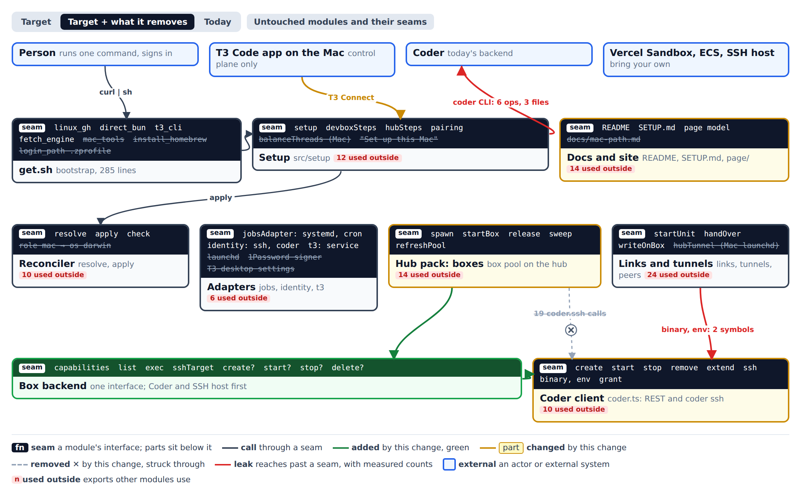
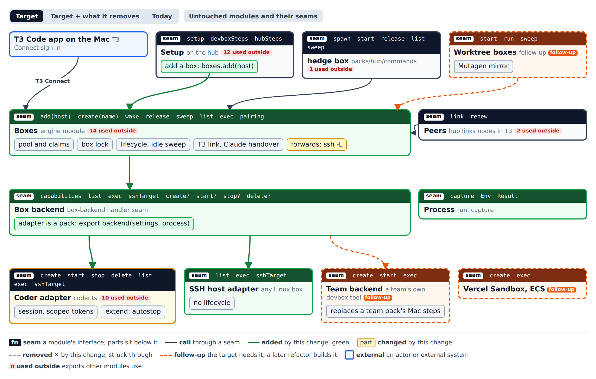
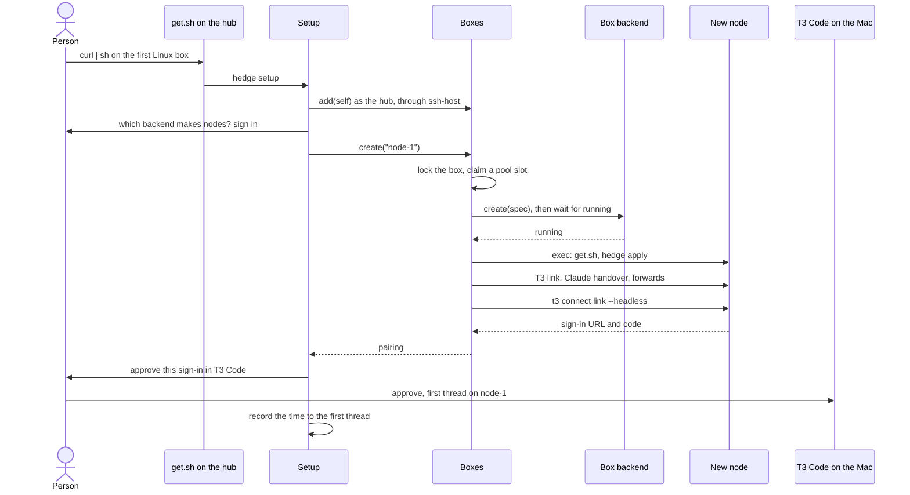
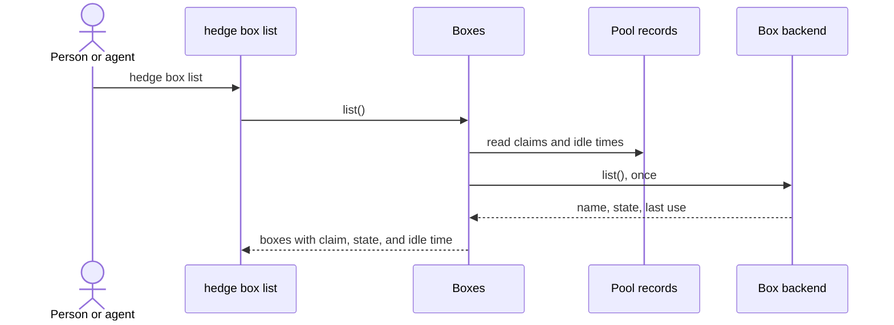
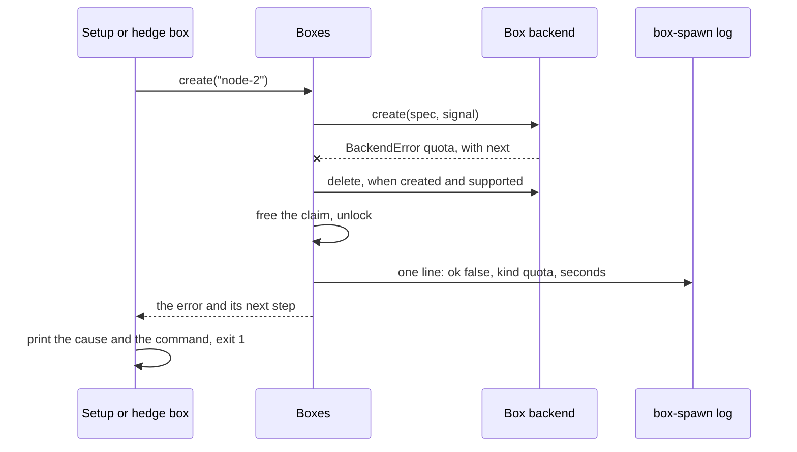

# Hedge refocus: cloud boxes only, and a Box backend seam

Status: accepted, 2026-11-20. The cloud-only part ships in
[#284](https://github.com/PostHog/hedge/pull/284). This spec adds the Box
backend seam and the slices that build it.

## The question

Hedge must do one thing well: run coding agents on Linux boxes that stay on,
and let a person steer them from T3 Code on a Mac or a phone. Two parts of
the engine work against that focus:

1. **The Mac path.** About 80 lines of `get.sh`, the `mac` role, launchd,
   Homebrew, the 1Password signer, T3 desktop settings, and the hub tunnel
   exist only to set up a Mac. Each one is a second way to do the same
   thing, and each one slows down setup and tests.
2. **Coder is wired in.** The box pool on the hub, setup, and the links
   call the Coder CLI directly: 19 `coder.ssh` calls outside `coder.ts`, 6
   Coder CLI operations in 3 setup files, and `capture`, `Env`, and
   `Result` imported from `coder.ts` by 13 files. A person who has their
   own machines, or a Vercel Sandbox, ECS, or a team devbox tool, cannot
   use Hedge.

The decisions:

- The Mac runs nothing from Hedge. It runs only the T3 Code app and reaches
  the boxes through T3 Connect ([ADR 0001](../adr/0001-mac-runs-only-t3-code.md)).
- Boxes is one engine module. It is the only caller of a Box backend
  ([ADR 0003](../adr/0003-boxes-is-the-only-backend-caller.md)).
- A Box backend adapter is a pack behind a `box-backend` handler seam, with
  a capability set ([ADR 0002](../adr/0002-box-backends-are-packs.md)).
  The `coder` and `ssh-host` packs ship with the engine.
- A backend failure is never retried in silence
  ([ADR 0004](../adr/0004-no-silent-backend-retry.md)).
- The target is a first thread in under 10 minutes on a fresh account,
  with under 60 seconds of machine work.
- It ships as one breaking release. Profiles drop their Mac machine, and
  team packs drop their darwin items.

Out of scope: a Mac workstation setup, and a Cursor adapter.

## Rung 1: the system

[rung1.html](hedge-refocus/rung1.html) is the full page, with Target, Target
plus what it removes, and Today. "Today" is `main` before #284.



- The person runs one command on a Linux box. The Mac only signs in to T3
  Connect.
- Struck through: everything that sets up a Mac.
- Red: the leaks into Coder that the Box backend seam closes.

## Rung 2: the modules

[rung2.html](hedge-refocus/rung2.html) is the full page.



- **Boxes** takes the box pool, the claims, the box lock, the lifecycle and
  idle sweep, the T3 link, and the Claude handover from the Hub pack. It
  becomes an engine module with one interface.
- **Box backend** is the seam. Each adapter is a pack that exports one
  `backend` function.
- **Process** holds `capture`, `Env`, and `Result`, which move out of
  `coder.ts`.
- Orange frames are follow-ups that the target needs and a later change
  builds.

## Contracts

```ts
type Capability = "create" | "start" | "stop" | "delete" | "image";
type BoxState = "running" | "starting" | "stopped" | "failed" | "missing";

class BackendError extends Error {
  kind: "quota" | "timeout" | "auth" | "refused" | "unavailable";
  next?: string;
}

type BoxBackend = {
  name: string;
  capabilities: ReadonlySet<Capability>;
  list(): Promise<Array<{ name: string; state: BoxState; lastUsedAt?: number }>>;
  exec(box: string, command: string, options?: { stdin?: string; signal?: AbortSignal }): Promise<Result>;
  sshTarget(box: string): Promise<string>;
  create?(spec: { name: string; diskGigabytes: number; image?: string }, signal: AbortSignal): Promise<void>;
  start?(box: string, signal: AbortSignal): Promise<void>;
  stop?(box: string, signal: AbortSignal): Promise<void>;
  delete?(box: string, signal: AbortSignal): Promise<void>;
};

export function backend(settings: unknown, process: Process): BoxBackend;

type Boxes = {
  add(host: string): Promise<Box>;
  create(name: string): Promise<Box>;
  wake(name: string): Promise<Box>;
  release(name: string, options?: { force?: boolean }): Promise<void>;
  list(): Promise<Box[]>;
  sweep(): Promise<SweepReport>;
  exec(name: string, command: string): Promise<Result>;
  pairing(name: string): Promise<{ url: string; code: string }>;
};
```

`backend` is the export of a `box-backend` handler module. The pack lists it
in its handlers, as the `secret-rows` and `secret-providers` handlers do
today. `Boxes.pairing` runs `t3 connect link --headless` on the box and
returns the sign-in URL and code that the person approves.

### Invariants

- The hub holds one lock per box name.
- A failed `create` leaves no claim. When the backend has `delete`, it also
  leaves no half-made box.
- A command calls the backend's `list` at most once.
- `create` and `start` run under the start limit of 5 minutes.
- An optional operation is present only when its name is in
  `capabilities`. The engine checks this when it loads the pack.
- An error that is not a `BackendError` reads as `unavailable`.
- No command retries a backend call in silence.

### Error modes

| Kind | What Boxes does |
| --- | --- |
| `quota` | Prints the idle boxes that `sweep` would stop, and the command to run. |
| `timeout` | Deletes the half-made box when the backend has `delete`. Prints `next`. |
| `auth` | Prints the sign-in command from `next`. |
| `refused`, `unavailable` | Prints the cause and `next`, and exits 1. |

Each outcome, success or failure, adds one line to
`~/.local/state/hedge/box-spawn.jsonl`.

### Limits

- T3 Connect links up to 3 machines on a free account: the hub, one node,
  and the Mac. Past that, Boxes still creates the box, and `pairing` says the
  limit is reached and names the paid T3 plan or the machine to remove.
- The SSH host adapter has no lifecycle. Boxes probes each known host with
  `exec("true")` in place of `list`.

## Call paths

### Write: setup on the hub makes the first node



### Read: `hedge box list`



### Failure: the backend refuses or times out



## Thin slices

Each slice is one PR that a person can use on its own.

1. **Cloud only.** Done in [#284](https://github.com/PostHog/hedge/pull/284):
   `get.sh` installs nothing on a Mac, the site promises cloud boxes only,
   and setup signs the hub in to T3 Connect.
2. **Delete the dead Mac code.** The `mac` role and the `darwin` OS, the
   launchd adapter, the hub tunnel and `hub-https-trust`, the 1Password
   signer, T3 desktop settings, the Codex darwin step, the Mac branch of
   `balanceThreads`, the hub pull for a Mac, and `docs/mac-path.md`.
3. **Process, the Box backend seam, and the `coder` pack.** No change in
   behavior. The box tests run through the seam.
4. **The `ssh-host` pack and `hedge box add <host>`.** `hedge devbox add`
   goes through Boxes, and its Coder CLI calls move into the Coder adapter.
5. **Setup makes the first node through a backend.** The `image`
   capability for Coder, `Boxes.pairing` on each new node, and a setup
   timing for the time to the first thread.

## Follow-ups

| Follow-up | Strength |
| --- | --- |
| A team backend pack for a team's own devbox tool, which replaces that team pack's darwin steps | Strong: the first outside user of the seam |
| Worktree boxes on Boxes | Strong: one lifecycle and one sweep for all boxes |
| Vercel Sandbox and ECS adapters | Medium: wait for a person who asks |
| Dissolve the Hub pack into engine modules | Bold: the hub becomes an engine concept, as `docs/architecture.md` proposes |
